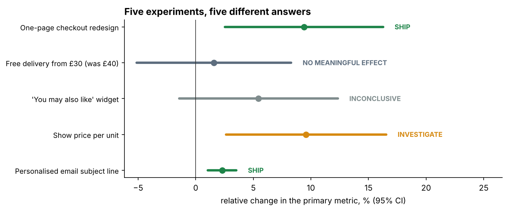
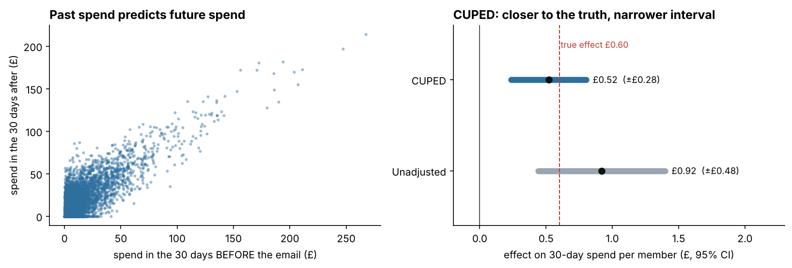
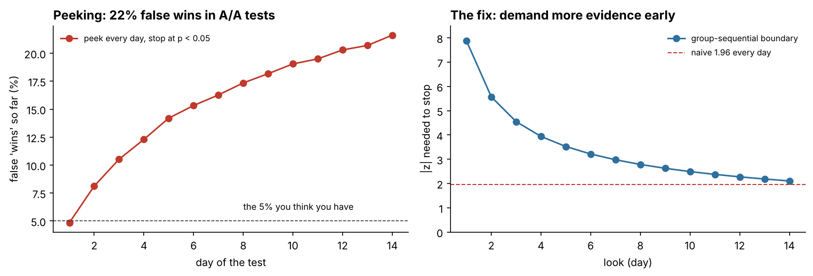
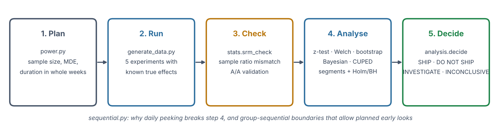
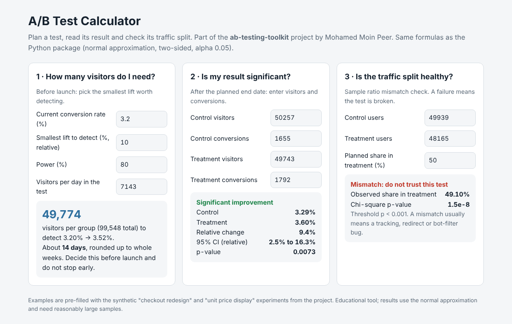

# A/B Testing Toolkit

A Python toolkit and worked case study for running online experiments properly. It covers planning the sample size, checking the test is healthy, analysing the result several ways, and reaching a clear **ship / don't ship** decision. It also includes a browser calculator that anyone can use.

> **All data is synthetic.** "Lagan Living" is a fictional online homeware retailer. Each of its five experiments was generated with a **known true effect**, so you can check whether the toolkit reaches the right conclusion.



## Five experiments, five different lessons

| Experiment | What really happened (built into the data) | Toolkit decision | The lesson |
|---|---|---|---|
| One-page checkout | +10% conversion | **SHIP**: +9.4%, p = 0.007, P(better) 99.6% | A well-powered test finds a real effect |
| Free delivery from £30 | +6% conversion but −5% basket value | **NO MEANINGFUL EFFECT**: CI rules out the +10% we planned for; revenue per visitor −2% (n.s.) | Look beyond conversion; trade-offs hide in revenue |
| "You may also like" widget | No effect | **INCONCLUSIVE**: p = 0.12. One segment looked "significant" (p = 0.02) until adjusted (Holm p = 0.08) | Slicing into segments creates false wins |
| Show price per unit | +3% conversion, **plus a tracking bug** that lost some treatment visitors | **INVESTIGATE**: 49.1% / 50.9% split, SRM p = 1.5×10⁻⁸ | Check the split first; the apparent +9.6% is not trustworthy |
| Personalised email subject | +£0.60 on 30-day spend | **SHIP**: CUPED estimate +£0.52 (95% CI £0.24 to £0.80) | Using pre-period data cuts noise and corrects chance imbalance |

### Highlights

* **Planning.** Detecting a 10% lift on a 3.2% conversion rate needs **49,774 visitors per group**, which is 14 days of traffic. Both figures are checked against statsmodels in the tests.
* **CUPED** removed **65% of the variance** and made the confidence interval **41% narrower**. Before the email, the treatment group already spent £0.47 more by chance, which inflated the unadjusted estimate to £0.92. CUPED brought it to £0.52, close to the true £0.60.
* **Peeking.** Checking every day and stopping at p < 0.05 produced false wins in **21.6%** of A/A tests (no real effect), against the 5% you think you have. Group-sequential (O'Brien-Fleming-style) boundaries bring it back to **4.8%**. With a real 10% effect, they keep 77% power and stop on day 11 on average.
* **Testing the test.** In 2,000 simulated A/A tests the z-test produced **5.1%** false positives, and its p-values were spread evenly from 0 to 1.




## What the toolkit does

```
Plan  →  Run  →  Check  →  Analyse  →  Decide
```



| Step | Module | What it does |
|---|---|---|
| Plan | `power.py` | Sample size for conversion rates and means, minimum detectable effect, achieved power, duration rounded up to whole weeks |
| Check | `stats.srm_check` | Sample ratio mismatch (chi-square, p < 0.001); A/A validation of the tests themselves |
| Analyse | `stats.py` | Two-proportion z-test, Welch t-test, bootstrap (percentile and Poisson) for skewed revenue, Bayesian Beta-Binomial with P(better) and expected loss, CUPED, Bonferroni/Holm/Benjamini-Hochberg adjustments |
| Monitor | `sequential.py` | Peeking simulation and group-sequential boundaries |
| Decide | `analysis.decide` | Explicit rules: SRM → INVESTIGATE; guardrail harmed → DO NOT SHIP; significant up → SHIP; significant down → DO NOT SHIP; otherwise NO MEANINGFUL EFFECT or INCONCLUSIVE, depending on whether the CI rules out the planned effect |
| Report | `reporting.py` | One Markdown decision report per experiment, 9 figures, CSV and JSON results |

Each experiment report (`outputs/reports/*.md`) covers the hypothesis and the pre-registered plan, the health check, a results table for the primary, secondary and guardrail metrics, the Bayesian check and a segment table with adjusted p-values. It ends with the decision and the reason.

## Browser calculator

`web/index.html` is a single page with no installation, ready to publish with GitHub Pages. It has three tools: **sample size**, **significance** and **traffic-split (SRM) check**. It uses the same formulas as the Python package and is pre-filled with this project's examples.



## Quick start

```bash
python -m venv .venv
.venv\Scripts\activate             # Windows  (macOS/Linux: source .venv/bin/activate)
pip install -r requirements.txt
pip install -e .

python -m ab_toolkit all           # generate data + analyse all 5 experiments (~30 s)
python -m ab_toolkit plan --baseline 0.05 --mde 0.05 --daily 20000   # plan your own test
pytest                             # 24 tests
start web\index.html               # the calculator (macOS: open, Linux: xdg-open)
```

## Project structure

```
ab-testing-toolkit/
├── src/ab_toolkit/
│   ├── power.py          sample size, MDE, power, duration
│   ├── stats.py          tests, bootstrap, Bayesian, CUPED, SRM, p-value adjustment
│   ├── sequential.py     peeking simulation, group-sequential boundaries
│   ├── analysis.py       experiment definitions, decision rules, A/A validation
│   ├── generate_data.py  5 synthetic experiments with known effects
│   ├── reporting.py      reports, figures, results
│   └── __main__.py       CLI: data | analyse | all | plan
├── web/index.html        browser calculator (GitHub Pages ready)
├── outputs/reports/      one decision report per experiment
├── outputs/figures/      9 charts
├── outputs/results/      experiment_summary.csv, segments.csv, summary.json
├── tests/                24 tests (checked against statsmodels and SciPy)
└── docs/                 workflow diagram, presentation, final report
```

## Honest limitations

* The data is synthetic and every experiment is clean apart from the deliberate bug. Real tests also face novelty effects, interference between users and messy tracking.
* Users are the unit of analysis. Ratio metrics measured per session, such as revenue per session, would need the delta method.
* The group-sequential boundaries are calibrated by simulation for equally spaced looks. Production systems often use alpha-spending functions with unequal looks.
* The Bayesian analysis uses a flat Beta(1,1) prior. For the widget test with no true effect it still gave P(better) = 94%, which is why the decision rules are based on confidence intervals and pre-registered effect sizes, not on P(better) alone.

## Skills shown

Experiment design and power analysis · hypothesis testing (z, Welch, bootstrap) · Bayesian A/B testing · variance reduction (CUPED) · sample ratio mismatch checks · multiple-testing correction · sequential testing · simulation · decision frameworks · Python (NumPy, SciPy, statsmodels, pandas, matplotlib) · JavaScript · testing.

## Licence

MIT © 2026 Mohamed Moin Peer. The data is synthetic and generated by `generate_data.py`.
